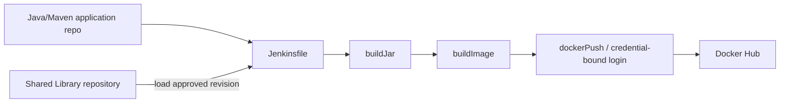

# Jenkins Shared Library — TechWorld with Nana DevOps Bootcamp

> **Status:** Source reviewed on 21 October 2026. Real Jenkins loading and successful pipeline execution not yet independently validated.
>
> **Library code snapshot:** [`2873abfc37c8`](https://github.com/asambataiden/jenkins-shared-library/tree/2873abfc37c87a3abbfe1075aa491e9aa235ef91)
>
> **Consumer pipeline:** [`asambataiden/twn-devops-bootcamp`](https://github.com/asambataiden/twn-devops-bootcamp) · [Draft documentation PR #8](https://github.com/asambataiden/twn-devops-bootcamp/pull/8)

## 1. Purpose

This repository extracts repeated Groovy logic from a Jenkinsfile into reusable, version-controlled pipeline steps. It is a hands-on **Jenkins Shared Library** learning exercise, not a general-purpose production deployment framework.

The consumer project explores Maven builds, Docker image construction and publishing, and later EC2 deployment. This library currently implements build/registry helper steps, **not an actual remote deployment helper**.

## 2. Structure and observed functions

```text
jenkins-shared-library/
├── vars/
│   ├── buildJar.groovy
│   ├── buildImage.groovy
│   ├── dockerLogin.groovy
│   ├── dockerPush.groovy
│   └── deployApp.groovy
├── src/
│   └── com/example/Docker.groovy
├── lib/            # Local Groovy artifacts present in historical repo
└── .gitignore
```

| Callable step | Actual behavior in inspected source |
|---|---|
| `buildJar()` | Runs `mvn clean package` |
| `buildImage(imageName)` | Calls `Docker.buildDockerImage(imageName)` |
| `dockerLogin()` | Calls `Docker.dockerLogin()` |
| `dockerPush(imageName)` | Logs in via `Docker.dockerLogin()` and pushes the image |
| `deployApp()` | **Echo-only placeholder**, not a remote deployer |

`src/com/example/Docker.groovy` wraps Docker CLI commands and Jenkins credential binding.

## 3. Integration architecture



The consumer Jenkinsfile references `@Library('jenkins-shared-library') _` and invokes functions exposed by the `vars/` scripts. Library lookup and trust settings reside in Jenkins configuration, not in this repository.

## 4. Jenkins prerequisites

- Jenkins controller/agents with compatible Pipeline and Shared Library plugins.
- Git/SCM access to this repository and a Global Pipeline Library configuration using **the exact library name** `jenkins-shared-library`.
- A compatible Maven installation available as `mvn` on the build agent.
- A Docker-capable build agent with authorization to build images.
- A scoped Jenkins username/password credential stored under ID `docker-hub-repo-asambataiden` for registry authentication.

The credential identifier is an **ID**, not a credential value. Never commit the token or export it into logs.

## 5. Typical consumer use

The snippet below is **illustrative** of how the reviewed library's functions are called, not a verified independent pipeline:

```groovy
@Library('jenkins-shared-library') _

pipeline {
    agent any
    stages {
        stage('Package') {
            steps { script { buildJar() } }
        }
        stage('Build image') {
            steps {
                script { buildImage('example/app:review-only') }
            }
        }
    }
}
```

Do not run this without a correctly configured Jenkins library, Docker daemon and access controls. For the actual bootcamp Jenkinsfiles, see [the consumer repository](https://github.com/asambataiden/twn-devops-bootcamp).

## 6. Validation and documentation

See [functions and implementation notes](docs/functions.md) and [validation/security requirements](docs/validation-and-security.md).

**Observed:** source files exist and have the described commands. **Not observed:** a successful Shared Library import, Jenkins build/push execution, library unit tests or remote deployment.

## 7. Engineering learning and improvements

The library demonstrates separation of pipeline orchestration from reusable Docker/Maven operations. For a later production-oriented iteration, consider:

- Pinning an approved version/revision of the library in consumers.
- Unit-testing Groovy pipeline steps and defining stable function contracts.
- Avoiding Docker registry credentials in long-lived agent filesystems.
- Scoping registry permissions, managing token rotation and limiting agent privileges.
- Removing unnecessary large local dependency JARs and IDE artifacts, with separate cleanup PR.
- Implementing deployment as a tested step only after health checks and rollback requirements are defined.

These are **recommendations, not features claimed as implemented**.

## 8. Attribution

Documented from hands-on work associated with TechWorld with Nana's DevOps Bootcamp. The original course materials remain the creator's intellectual property. Historical Git commits and source code are preserved.

[Return to the bootcamp portfolio](https://github.com/asambataiden/twn-devops-bootcamp-portfolio).
