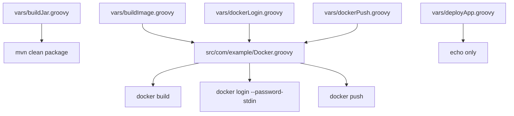

# Shared Library function contract and source evidence

**Reviewed revision:** [`2873abfc37c8`](https://github.com/asambataiden/jenkins-shared-library/tree/2873abfc37c87a3abbfe1075aa491e9aa235ef91) · **State:** code reviewed, execution pending.

## Call graph

## Step definitions

### `buildJar()`

- No explicit arguments in inspected source.
- Calls Jenkins `sh 'mvn clean package'`.
- Assumes Maven and JDK exist and workspace contains a `pom.xml`.
- Uses `GIT_BRANCH` in an informational echo statement.

### `buildImage(String imageName)`

- Delegates to a serializable `Docker` Groovy class.
- Calls `docker build -t <imageName> .` in the workspace.
- Image-name validation and Docker agent capabilities are **not** enforced by the helper.

### `dockerLogin()`

- Binds a Jenkins username/password credential named `docker-hub-repo-asambataiden` to environment variables.
- Sends the password through standard input to `docker login --password-stdin`.
- Avoids embedding a literal token in source code. Do not assume this alone makes the agent's Docker credential cache safe.

### `dockerPush(String imageName)`

- Calls the Docker helper's login method and runs `docker push <imageName>`.
- Actual registry success, digest and permissions are not yet verified in the documentation evidence.

### `deployApp()`

- Logs a message only.
- **No container orchestration, SSH command, status check, rollback or actual deployment.**

## Compatibility and implementation caveats

- Exact Jenkins plugin, agent and Groovy CPS compatibility must be tested.
- The library's startup source includes historical interpreter header spelling and local Groovy JAR artifacts; assess necessity in a separate maintenance PR.
- Credentials should be scoped to pipeline jobs and rotated periodically; avoid Docker daemon privilege escalation on untrusted changes.
- Pin trusted library revisions for production/reproducibility.

See [validation and security](validation-and-security.md).
